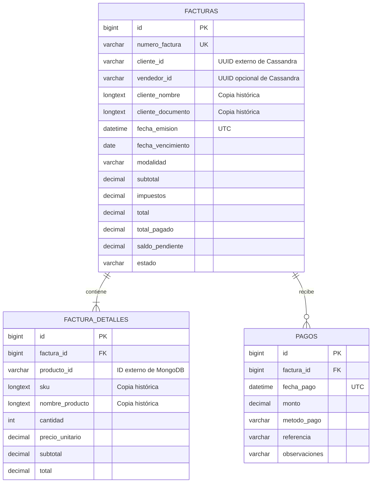
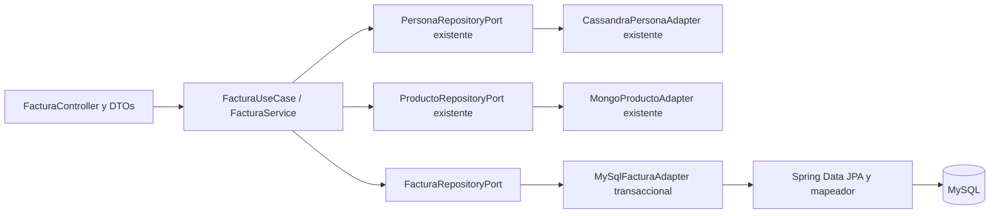

# Fase 5 — Ventas y facturación en MySQL

Implementación y verificación del 4 de noviembre de 2026, hora de Colombia. Solo se amplía el backend monolítico existente. Se conservan los módulos de productos, imágenes, personas y roles, sus cambios locales previos y los volúmenes de Docker.

## Modelo relacional



Las tres tablas usan InnoDB. Cada PK es `BIGINT AUTO_INCREMENT`; `numero_factura` tiene índice único. Se indexan cliente/fecha, fecha de emisión y factura/fecha de pago. `(factura_id, producto_id)` es único: el servicio consolida las repeticiones antes de guardar. Las claves foráneas de detalles y pagos protegen la cabecera, sin borrado en cascada. No existen claves foráneas hacia MongoDB o Cassandra.

Importes `DECIMAL(50,2)` y `BigDecimal`, con dos decimales exactos. Esto permite multiplicar los precios del catálogo, que admiten 32 enteros, por cantidades `int` positivas y sumar hasta 1000 líneas sin perder precisión. Se rechazan importes negativos, pagos cero y fracciones de centavo. Los campos históricos de texto no añaden límites artificiales a los nombres/SKU/documentos admitidos en las fases anteriores. Referencia de pago: hasta 255 caracteres; observaciones: hasta 2000.

Las restricciones SQL comprueban modalidades, métodos de pago, importes positivos, coherencia de totales/saldos/estados y vencimiento obligatorio para crédito. El dominio comprueba además la suma de detalles y pagos y las reglas de emisión. No hay impuestos configurados: `impuestos=0.00`, `totalDetalle=subtotalDetalle`.

## Migraciones y numeración

`backend/src/main/resources/db/migration/V1__facturacion.sql` se ejecuta con Flyway al arrancar el backend. La historia queda en `flyway_schema_history`. Esta migración también funciona sobre el volumen MySQL anterior: no depende de `/docker-entrypoint-initdb.d`. Para un esquema no vacío sin historia se configura baseline 0 y se ejecuta V1; una colisión con tablas preexistentes provoca error sin sobrescribirlas. Flyway clean está deshabilitado e Hibernate usa `ddl-auto=validate`. Referencia de configuración: [documentación oficial de Spring Boot](https://docs.spring.io/spring-boot/how-to/data-initialization.html).

La creación inserta un número temporal `TMP-<UUID>` único y no nulo, obtiene el ID de MySQL y lo sustituye por `FAC-<id>` dentro de la misma transacción. Solo se devuelve el número definitivo después de completarse la operación. No se usa `SELECT MAX`. Las solicitudes concurrentes reciben IDs y números distintos; un rollback puede dejar saltos en la secuencia.

El datasource usa las variables ya existentes `MYSQL_HOST`, `MYSQL_PORT`, `MYSQL_DATABASE`, `MYSQL_USER` y `MYSQL_PASSWORD`. Compose espera la salud de `facturacion-mysql`, accesible en `facturacion-mysql:3306`. Se conservan red, credenciales y volúmenes; no se publica 3306 en Windows. Fechas de emisión/pago como `Instant`, almacenadas en UTC con precisión de milisegundos; vencimiento como `LocalDate`. La fecha mínima de vencimiento se calcula en `America/Bogota`.

## Organización hexagonal e integración de las tres bases



1. El servicio consulta la persona por UUID mediante el puerto existente. Debe estar activa y tener `CLIENTE`. Si hay vendedor, se consulta por el mismo puerto y debe estar activo y tener `TRABAJADOR` o `ADMINISTRADOR`.
2. Valida cantidades enteras positivas, consolida productos repetidos y consulta cada producto por el puerto existente de MongoDB. Rechaza productos inexistentes o inactivos. El precio se obtiene exclusivamente del catálogo.
3. El dominio calcula detalles, subtotal, total, pagos, saldo y estado. Toma una copia del cliente y de SKU/nombre/precio de cada producto.
4. Una vez terminadas las lecturas externas, el adaptador MySQL inicia la transacción y guarda factura, detalles y pagos iniciales. Cualquier excepción provoca rollback completo.
5. Los abonos posteriores solo necesitan MySQL: bloquean la cabecera con `PESSIMISTIC_WRITE` (`SELECT ... FOR UPDATE`), cargan el saldo actual, aplican la regla de dominio y guardan pago y saldo en la misma transacción con aislamiento `READ_COMMITTED`. El segundo abono concurrente valida el saldo dejado por el primero.
6. Las consultas históricas leen exclusivamente MySQL, sin recalcular precios ni nombres desde los motores externos. No hay transacciones distribuidas ni modificaciones de existencias.

Dominio y aplicación solo importan Java y contratos del proyecto. Las anotaciones `@Transactional`, entidades y repositorios JPA viven en infraestructura. Se reutilizan los puertos/adaptadores anteriores; no se duplican productos ni personas.

## API y reglas de pagos

| Método | Endpoint | Resultado |
| --- | --- | --- |
| POST | `/api/facturas` | 201, factura completa y `Location` |
| GET | `/api/facturas` | 200, historial por ID descendente |
| GET | `/api/facturas/{id}` | 200, factura, detalles y pagos |
| GET | `/api/facturas/cliente/{clienteId}` | 200, lista del UUID indicado, incluso vacía |
| POST | `/api/facturas/{id}/pagos` | 200, factura actualizada |

Contado exige pagos iniciales cuya suma sea exactamente el total y se crea `PAGADA`. Puede mezclar efectivo, transferencia y Nequi. Crédito exige vencimiento, admite cero o varios pagos iniciales y nuevos abonos positivos hasta completar el total. `referencia` y `observaciones` son opcionales. Los pagos vencidos se aceptan: no hay intereses ni recargos.

| Condición | Estado |
| --- | --- |
| Total pagado = total | `PAGADA`, saldo cero |
| Total pagado = cero y total > cero | `PENDIENTE` |
| Cero < total pagado < total | `PARCIAL` |

Se rechaza pagar más del saldo o abonar a una factura de contado o ya pagada. La API no ofrece edición de totales/estado. Los campos monetarios/estado extra enviados por el cliente se ignoran. Máximo 1000 líneas de entrada y 100 pagos iniciales. La consolidación de cantidades comprueba desbordamiento de `int`.

Los errores conservan `ProblemDetail`: 400 para JSON, cantidades, importes, modalidad/vencimiento y contado incompleto; 404 para persona/producto/factura ausentes; 409 para estado/rol no habilitado, producto inactivo y sobrepago o factura cerrada. Los errores de validación HTTP incluyen el mapa `errores` existente.

### Ejemplos ejecutables con identificadores reales

El script `scripts/Test-FacturasDocker.ps1` crea personas y productos reales mediante la API y utiliza los IDs devueltos, sin placeholders. La prueba guarda las respuestas relevantes como evidencia antes de limpiar sus propios datos. Los ejemplos siguientes usan las variables reales `$persona`, `$p1`, `$p2` devueltas por esas creaciones:

```powershell
$credito = @{
    clienteId = $persona.id; modalidad = 'CREDITO'; fechaVencimiento = '2099-12-15'
    detalles = @(@{productoId=$p1.id; cantidad=3}, @{productoId=$p2.id; cantidad=2})
    pagosIniciales = @(@{metodoPago='NEQUI'; monto=[decimal]1000.10; referencia='INICIAL'})
}
# P1 cuesta 10000.25 y P2 cuesta 2000.10.
# Total: 34000.95; pagado: 1000.10; saldo: 33000.85; estado: PARCIAL.
$factura = Invoke-RestMethod "$base/api/facturas" -Method Post -ContentType 'application/json' -Body ($credito | ConvertTo-Json -Depth 8)

$contado = @{
    clienteId=$persona.id; modalidad='CONTADO'
    detalles=@(@{productoId=$p1.id; cantidad=1}, @{productoId=$p2.id; cantidad=1})
    pagosIniciales=@(@{metodoPago='EFECTIVO'; monto=10000},
                     @{metodoPago='TRANSFERENCIA'; monto=[decimal]2000.35; referencia='TR-001'})
}
# Total: 12000.35; saldo: 0; estado: PAGADA.
Invoke-RestMethod "$base/api/facturas" -Method Post -ContentType 'application/json' -Body ($contado | ConvertTo-Json -Depth 8)

Invoke-RestMethod "$base/api/facturas/$($factura.id)/pagos" -Method Post -ContentType 'application/json' -Body '{"metodoPago":"TRANSFERENCIA","monto":5000.25,"referencia":"ABONO-001"}'
# Nuevo saldo: 28000.60.
```

## Archivos de la fase 5

Todos los archivos Java están bajo `backend/src/main/java/com/sttiv/facturacion/` salvo indicación contraria.

| Ruta | Archivos creados |
| --- | --- |
| `domain/model/` | `Factura.java`, `DetalleFactura.java`, `Pago.java`, `ModalidadVenta.java`, `EstadoFactura.java`, `MetodoPago.java`, `Importe.java` |
| `domain/exception/` | `ConflictoFacturaException.java` |
| `domain/port/` | `FacturaRepositoryPort.java` |
| `application/command/` | `FacturaCommand.java`, `PagoCommand.java` |
| `application/port/` | `FacturaUseCase.java` |
| `application/usecase/` | `FacturaService.java` |
| `infrastructure/adapter/input/rest/` | `FacturaController.java` |
| `infrastructure/adapter/input/rest/dto/` | `FacturaRequest.java`, `PagoRequest.java`, `FacturaResponse.java` con DTOs de detalle/pago de salida |
| `infrastructure/adapter/output/mysql/` | `FacturaJpaEntity.java`, `DetalleFacturaJpaEntity.java`, `PagoJpaEntity.java`, `FacturaJpaMapper.java`, `SpringDataFacturaRepository.java`, `MySqlFacturaAdapter.java` |
| `infrastructure/config/` | `FacturaConfiguration.java` |
| `backend/src/main/resources/db/migration/` | `V1__facturacion.sql` |
| `backend/src/test/java/com/sttiv/facturacion/` | `FacturasFixtures.java`, `application/FacturaServiceTests.java`, `infrastructure/FacturaControllerTests.java`, `FacturaPersistenciaContract.java`, `FacturaJpaTests.java`, `MySqlFacturaIntegrationTests.java` (los tres últimos en `infrastructure/`) |
| `scripts/` | `Test-FacturasDocker.ps1`, `Test-MySqlDocker.ps1` |
| `docs/` | Este informe y las evidencias de fase 5 enlazadas abajo |

Modificados: `README.md`, `backend/pom.xml`, propiedades principales y de pruebas, `ApiExceptionHandler.java` y el comentario de responsabilidades de bases en `docker-compose.yml`. El resto de la configuración Compose de salud/variables/puertos ya servía para esta fase. `Dockerfile`, `.env`, módulos anteriores y volúmenes no requirieron cambios. Los cambios anteriores que ya estaban sin commit se conservaron. No se realizaron commits ni push.

## Resultados y evidencia de ejecución

| Verificación ejecutada | Resultado real |
| --- | --- |
| `mvn --batch-mode --no-transfer-progress verify` local | 81 pruebas ejecutadas, cero fallos/errores; cinco casos MySQL omitidos por ser opt-in |
| `docker compose build facturacion-backend`, Java 21 | Construcción y `clean verify` correctos; mismas 81 pruebas aprobadas |
| `Test-MySqlDocker.ps1`, Java 21, MySQL 8.4.13 | Cinco pruebas ejecutadas, cero fallos/errores/omitidas |
| `Test-FacturasDocker.ps1`, API y tres bases reales | 66 comprobaciones aprobadas, incluido reinicio del backend y limpieza |
| `Test-ProductosDocker.ps1`, regresión de fase 3 | 44 comprobaciones aprobadas, incluido GridFS y reinicio |
| `Test-PersonasDocker.ps1`, regresión de fase 4 | 72 comprobaciones aprobadas, incluida unicidad concurrente de documento y reinicio |

Resumen de Maven: [fase5-pruebas.txt](fase5-pruebas.txt). La suite de dominio contiene 18 pruebas nuevas; el controlador, cinco; el contrato de persistencia, cinco que se ejecutan tanto con H2 como con MySQL. Las 53 pruebas anteriores también se ejecutaron correctamente.

La prueba de rollback inyecta una falla antes del commit **después de comprobar por JDBC que existen la cabecera, el detalle y el pago inicial dentro de la transacción**. Después del error, una consulta independiente confirma cero filas propias en las tres tablas. Otra prueba provoca una violación real de la restricción única de detalle: MySQL devuelve 1062 y revierte también la cabecera y el detalle previo. Ese error SQL es esperado y forma parte de una prueba aprobada.

Doce creaciones concurrentes generaron doce números `FAC-{id}` distintos. Dos abonos JPA de 15000.00 contra saldo 20000.50 produjeron un éxito y un conflicto de dominio: saldo final 5000.50, sin pagos duplicados ni saldo negativo. El último abono de 5000.50 dejó la factura pagada. La prueba HTTP repitió la concurrencia con dos pagos de 1500.00 frente a un saldo de 2000.10: HTTP **200 y 409**, un pago almacenado y saldo 500.10.

### Facturas reales de extremo a extremo

| Factura | Modalidad | Total COP | Resultado |
| --- | --- | --- | --- |
| `FAC-20`, ID 20 | Crédito | 34000.95 | Inicial Nequi 1000.10 → saldo 33000.85; transferencia 5000.25 → saldo 28000.60; efectivo 28000.60 → `PAGADA`, saldo 0, tres pagos |
| `FAC-21`, ID 21 | Contado | 12000.35 | Efectivo 10000.00 + transferencia 2000.35, `PAGADA`, saldo 0 |
| `FAC-22`, ID 22 | Crédito | 2000.10 | Creada sin inicial y con vendedor validado; concurrencia de abonos → un pago 1500.00 y saldo 500.10 |

Cliente real ficticio de `FAC-20`: `9a41b6ed-ccee-448a-a38a-badcc3be26ba`. Se emitió el **4 de noviembre de 2026 a las 19:36:47.865 de Colombia**, almacenado como `2026-11-05T00:36:47.865Z`.

Ejemplo resumido de la respuesta de creación real:

```json
{
  "id": 20,
  "numeroFactura": "FAC-20",
  "clienteId": "9a41b6ed-ccee-448a-a38a-badcc3be26ba",
  "modalidad": "CREDITO",
  "subtotal": 34000.95,
  "impuestos": 0.00,
  "total": 34000.95,
  "totalPagado": 1000.10,
  "saldoPendiente": 33000.85,
  "estado": "PARCIAL"
}
```

Respuestas completas con IDs de productos, detalles y pagos: [creación de FAC-20](fase5-factura-creada.json), [contado FAC-21](fase5-factura-contado.json) y [FAC-20 pagada](fase5-factura-pagada.json).

### Evidencia de persistencia y lecturas entre motores

Se reinició únicamente el backend después de registrar el segundo pago de `FAC-20`. La factura completa recuperada después fue idéntica, campo por campo y byte por byte en los JSON guardados. En ambos archivos el SHA-256 es `FA8327B5F60BF13D330C0F25663ADFDE128C393C9A81460D7CF9B84B4D0C090F`:

- [Factura antes del reinicio](fase5-antes-reinicio.json).
- [Factura después del reinicio](fase5-despues-reinicio.json).
- [Consulta SQL directa antes](fase5-mysql-antes.json) y [después](fase5-mysql-despues.json): misma cabecera, IDs de detalles, IDs/montos de pagos, total y saldo.
- [Documento MongoDB](fase5-mongodb.json): precio cambiado a 99999.99 y SKU/nombre nuevos. La factura siguió conservando precio 10000.25, SKU y nombre de la venta.
- [Fila Cassandra del cliente](fase5-cassandra.json): UUID utilizado en la factura, estado activo y rol `CLIENTE`.
- [Comprobaciones HTTP, persistencia y limpieza](fase5-api-comprobaciones.txt).

Las facturas de demostración y sus personas/productos se eliminaron **después** de guardar la evidencia, exclusivamente mediante sus UUID y prefijos aleatorios. Los números de factura conservan los saltos normales de las pruebas y rollbacks. Los ejemplos archivados no implican que esos datos ficticios sigan disponibles por API.

La comprobación SQL final confirma `V1/facturacion/success=1`, las tres tablas InnoDB y cero filas restantes en facturas, detalles y pagos: [esquema y limpieza final](fase5-mysql-esquema-y-limpieza.txt). Antes de la fase no había tablas de facturación; no se eliminó información de usuarios.

Regresión: [44 comprobaciones de productos](fase5-productos-comprobaciones.txt), [MongoDB/GridFS de regresión](fase5-mongodb-regresion.json), [72 comprobaciones de personas](fase5-personas-comprobaciones.txt) y Cassandra de regresión [antes](fase5-cassandra-regresion-antes.json)/[después](fase5-cassandra-regresion-despues.json).

### Estado final de Docker

| Servicio | Estado final | Puerto publicado en Windows |
| --- | --- | --- |
| `facturacion-backend` | En ejecución, `healthy` | `127.0.0.1:8080` |
| `facturacion-mongodb` | En ejecución, `healthy` | Ninguno |
| `facturacion-cassandra` | En ejecución, `healthy` | Ninguno |
| `facturacion-mysql` | En ejecución, `healthy` | Ninguno |
| `facturacion-cassandra-init` | `Exited (0)`, ejecución única completada | Ninguno |

[Salida real de `docker compose ps -a`](fase5-contenedores.txt). `/api/health` respondió 200 con `status=OK` al finalizar. Las tres bases conservaron sus contenedores y volúmenes; solo se reconstruyó/recreó y reinició el backend. El contenedor temporal Maven de integración se eliminó al terminar.

### Incidencias resueltas durante la verificación

Se añadió al mapeo JPA la restricción única por factura/producto que ya estaba en la migración, para que la prueba H2 ejercitara la misma integridad. Se detectó además que el sondeo de reinicio podía intentar `::1` cuando Compose solo publica IPv4. El script de fase 5 ahora usa `127.0.0.1` y normaliza `localhost` a IPv4. La ejecución anterior se detuvo, se aplicó su limpieza selectiva y se repitió íntegramente la prueba: las 66 comprobaciones finales corresponden a la ejecución corregida. No quedan errores funcionales conocidos de la fase 5.

## Repetir la verificación

```powershell
cd backend
.\mvnw.cmd --batch-mode --no-transfer-progress clean verify
cd ..
docker compose config --quiet
docker compose build facturacion-backend
docker compose up -d --no-deps --no-build --wait --wait-timeout 120 facturacion-backend
pwsh -File ./scripts/Test-MySqlDocker.ps1
pwsh -File ./scripts/Test-FacturasDocker.ps1
pwsh -File ./scripts/Test-ProductosDocker.ps1
pwsh -File ./scripts/Test-PersonasDocker.ps1
docker compose ps -a
```

Las pruebas ordinarias ejecutan 81 casos y omiten intencionalmente cinco casos opt-in de MySQL. `Test-MySqlDocker.ps1` habilita esos cinco casos con `-Dapp.mysql.integration=true`, Java 21 y el `.env` existente dentro de la red Docker. No requiere publicar MySQL. Los tests no usan una transacción exterior de JUnit: cada operación cruza el proxy transaccional real, por lo que las aserciones de rollback/commit no dependen de un rollback automático de prueba. En H2 se prueba JPA; la migración y las restricciones MySQL se verifican separadamente en MySQL real.

Los scripts se ejecutan en secuencia porque los de extremo a extremo reinician el backend. Cada uno usa prefijos/UUID aleatorios y limpieza selectiva en `finally`. Facturas y sus hijos se eliminan primero por el UUID de cliente ficticio; después se retiran las personas, índices de Cassandra y productos asociados a los SKU de esa ejecución. No se eliminan bases, tablas, colecciones ni volúmenes.

## Límites conocidos

- Sin frontend, Druid, DIAN, autenticación, inventario, descuentos de existencias, microservicios ni transacciones distribuidas.
- Historial completo sin paginación, sin anulación, devoluciones ni modificación de facturas.
- No hay idempotencia por referencia de pago: las referencias son informativas y pueden repetirse. Ante timeout se debe consultar el historial antes de reintentar; el saldo está protegido frente a sobrepagos, pero un reintento puede registrar otro abono si todavía queda saldo suficiente.
- Las lecturas de personas/productos representan el momento previo a la escritura MySQL; sus estados pueden cambiar entre ambas operaciones. Las copias históricas se conservan.
- Impuestos cero, una sola moneda COP, sin configuración tributaria ni intereses de mora.
- Un total cero puede producir un crédito `PAGADA` sin pagos. Contado exige al menos un pago positivo que cubra exactamente el total; por ello una venta exclusivamente gratuita debe usar crédito en esta versión.
- MySQL/Cassandra/MongoDB son instancias únicas de desarrollo. La disponibilidad de `/api/health` no sustituye la comprobación de las operaciones reales ni de la salud de cada base.
