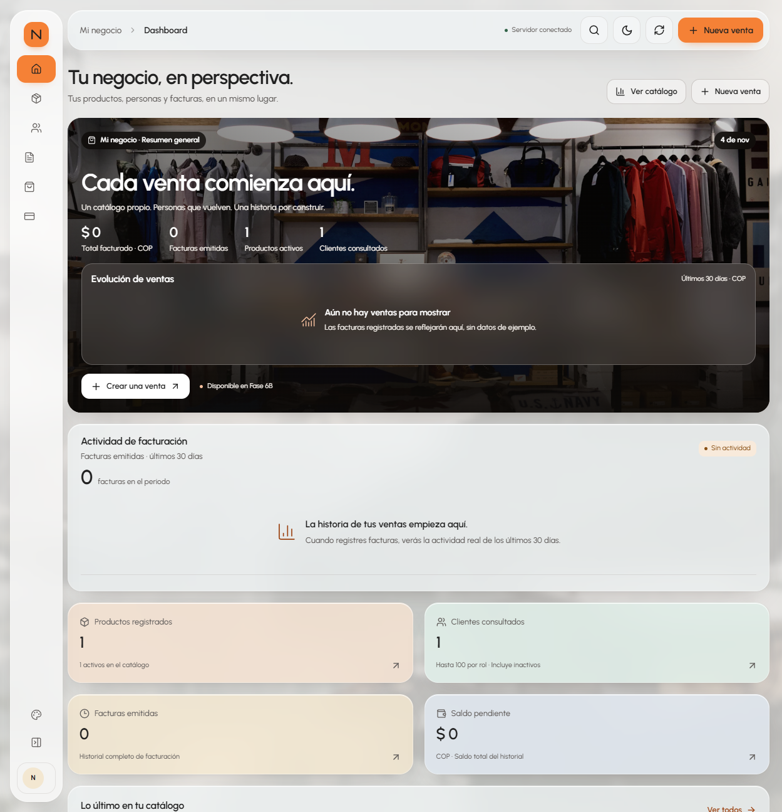

# Fase 6A.1 · Identidad visual de Nexo

## Nexo Design System

Nexo Design System es el sistema visual propio de la aplicación: tipografía Urbanist, paneles translúcidos, acento naranja, barra compacta de iconos, header flotante, hero horizontal, actividad y KPI pastel en dos columnas. Este informe conserva las medidas y verificaciones de la Fase 6A.1 a **1249 × 1295 px**.

Las capturas documentan el sistema Nexo antes y después de esa fase. La denominación del sistema visual no atribuye a Nexo la autoría de las fotografías ni de la fuente: su procedencia y licencias se conservan en la sección de recursos.

## Auditoría y reconstrucción

La versión inicial tenía una barra de 242 px, header plano, fondo azul petróleo/verde, KPI superiores en cuatro columnas y dos paneles del mismo nivel. La Fase 6A.1 estableció esta estructura:

1. Barra blanca translúcida de 84 px, a 16 px de los bordes, con marca naranja, iconos y tooltips. La barra queda fija y siempre visible, sin expansión, contracción ni panel de navegación móvil. En móvil mide 72 px y mantiene los bordes redondeados de 28 px, separada 8 px de la ventana.
2. Header de cristal independiente de 64 px, breadcrumb, búsqueda funcional, tema, actualización real y acceso a Nueva venta.
3. Encabezado editorial con acciones de catálogo y venta.
4. Hero fotográfico de 470 px con datos reales, oscurecimiento localizado, área de evolución y acceso a la siguiente fase.
5. Actividad horizontal de 267 px, seguida de cuatro KPI pastel en dos columnas.
6. Catálogo reciente, categorías, estados, resumen financiero y cambios recientes conservados debajo.

| Elemento a 1249 × 1295 | Nexo |
| --- | --- |
| Barra lateral visible | 84 px |
| Header flotante | 64 px |
| Inicio horizontal del contenido | 108 px |
| Hero | 1121 × 470 px |
| Posición vertical del hero | ~188 px |
| Actividad | 1121 × 267 px |
| Separación entre secciones | 18 px |
| KPI | 2 columnas, 128 px de altura |
| Radio de tarjetas principales | 22 px |
| Tipografía | Urbanist variable local |

Las medidas de esa fase se guardan en [nexo-medidas.json](capturas/fase6a1/nexo-medidas.json).

## Evidencia visual de Nexo



[Nexo antes del rediseño](capturas/fase6a1/nexo-antes.png) · [Después, tamaño original](capturas/fase6a1/nexo-despues.png) · [Tema oscuro](capturas/fase6a1/nexo-oscuro.png) · [Tablet](capturas/fase6a1/nexo-tablet.png) · [Móvil](capturas/fase6a1/nexo-movil.png).

Pantallas de trabajo: [Productos](capturas/fase6a1/nexo-productos.png), [Personas](capturas/fase6a1/nexo-personas.png), [Apariencia](capturas/fase6a1/nexo-apariencia.png) y [formulario lateral](capturas/fase6a1/nexo-formulario.png).

El área de evolución y la actividad muestran estados vacíos cuando las facturas disponibles no alcanzan para dibujar una serie; mantienen el espacio y la jerarquía visual. Los datos y las operaciones disponibles corresponden a Nexo.

## Sistema visual y recursos

Los tokens están en `frontend/src/styles/tokens.css`: acento **#F58136**, neutro **#F4F4F4**, cristal **#F2F6F8**, gráfico **#F4BF9D** y pasteles **#F6E2D2**, **#E1F0EA**, **#F3E7D1** y **#E3EAF2**. Texto principal **#202020**. El modo oscuro usa grises carbón y conserva el acento naranja. Los enlaces pequeños usan un naranja más oscuro para mantener contraste.

`styles.css` importa tokens, layout, componentes y adaptación responsive. Se retiraron los antiguos fondos azul petróleo, degradados ambientales y tokens de esa identidad. Los componentes funcionales conservan sus reglas de estado, foco y validación. CSS gestiona hover, navegación, paneles, diálogos y salida animada; `prefers-reduced-motion` reduce esas transiciones.

Urbanist se sirve desde `/fonts/urbanist-latin.woff2`, con pesos variables 400–700 y una descarga de unos 28 KB. Se incluye [SIL OFL 1.1](../frontend/public/fonts/OFL-Urbanist.txt), obtenida del [repositorio oficial de Google Fonts](https://github.com/google/fonts/tree/main/ofl/urbanist).

Las fotografías se descargaron de Unsplash bajo su [licencia de uso](https://unsplash.com/license), con fuentes en [CREDITOS.md](../frontend/public/media/CREDITOS.md). El hero ocupa unos 282 KB y cada fondo entre 97 y 107 KB, todos WebP locales. El navegador carga el fondo seleccionado; las opciones se previsualizan en Apariencia. Las fotografías ambientales no se presentan como imágenes del catálogo: los productos siguen mostrando sus imágenes GridFS reales.

Las preferencias de apariencia usan `nexo.appearance.v2`: el primer inicio de esta versión es claro y compacto, incluso si la versión anterior guardó oscuro. Las elecciones nuevas de tema, fondo, desenfoque y opacidad persisten. La barra siempre muestra los iconos; ignora las antiguas preferencias de expansión. Valores iniciales: Aurora, 26 px y 68%; rangos: desenfoque 8–32 px y opacidad 55–90%.

## Funcionalidad y datos

Se conservaron `api.ts`, los contratos TypeScript, los editores de productos/personas, las validaciones, las cargas GridFS, la asignación de roles y las desactivaciones. El descarte sigue abriendo una confirmación sobre el formulario existente. La búsqueda de secciones y el acceso por teclado siguen disponibles.

La evolución usa totales diarios de `/api/facturas`, agrupados por fecha de Colombia en los últimos 30 días; se dibuja con al menos dos días con facturas. La actividad cuenta facturas reales por día. Las sumas monetarias de presentación conservan centavos con BigInt. Los cálculos transaccionales siguen en Spring Boot. Los indicadores generales mantienen el historial completo y la etiqueta de hasta 100 clientes por rol.

Al cierre de la Fase 6A.1, Facturas, Nueva venta y Créditos y pagos tenían pantallas informativas. La [Fase 6B](FASE6B-VERIFICACION.md) incorporó después la emisión de facturas y el registro de pagos; esas funciones están disponibles en la versión actual.

## Verificación reproducible

Desde `frontend/`, con Chrome y los servicios existentes:

```powershell
npm run build
$env:UI_BASE_URL = 'http://127.0.0.1:5173'
$env:UI_MUTATION_TESTS = '0'
npm run test:e2e
node scripts/check-api-state.mjs after
node scripts/capture-redesign.mjs
```

Antes de una nueva verificación, `node scripts/check-api-state.mjs before` registra hashes de lectura y conteos de productos, facturas y los cuatro roles; la comparación posterior requiere ese registro. Los archivos no guardan contenido personal. Deben compararse sin modificaciones concurrentes del negocio.

La suite conserva las verificaciones anteriores de API, formularios, descarte, roles, filtros, preferencias, navegación y movimiento reducido. Añade inicio claro frente a preferencias antiguas, medidas del diseño, las siete rutas e imágenes reales. Se ejecuta a 1440×1000, 768×1024 y 375×812; las medidas del diseño se comprueban además a 1249×1295. Las solicitudes de escritura están bloqueadas en las pruebas de interfaz/rediseño.

El ajuste de la barra fija verifica que permanece visible al desplazarse, navegar y recargar, sin expandirse al pasar por sus iconos. También se revisaron cinco pantallas a 320 y 600 px sin desbordamiento horizontal. Capturas actualizadas de la barra en [escritorio](capturas/barra-fija/escritorio.png) y [móvil](capturas/barra-fija/movil.png).

Las seis pruebas de creación/edición/desactivación de la fase anterior se omiten expresamente para cumplir la instrucción de **no modificar datos de bases de datos**. Sus archivos permanecen disponibles. Los resultados se generan en `frontend/playwright-report/`; las capturas comparativas de esta fase se conservan en este directorio de documentación.

### Resultado final · 4 de noviembre de 2026

- Compilación de TypeScript/Vite y construcción de la imagen Docker completadas.
- **36 pruebas aprobadas y 6 de escritura omitidas**, en la última ejecución sobre Docker (1,5 minutos).
- Verificados ambos temas, las siete rutas, tres tamaños de pantalla, imágenes GridFS, formularios, descarte, roles, preferencias, errores y movimiento reducido. El navegador confirma `blur(26px)` en las superficies de producción y `blur(28px)` al cambiar y recargar la preferencia.
- Sidebar 84 px, header 64 px, hero 470 px desde y=188, actividad 267 px desde y=676 y KPI desde y=961; evidencia en `nexo-medidas.json`.
- Los cinco servicios permanecen saludables. Se actualizó exclusivamente el contenedor frontend.

La lectura inicial registró 1 producto, 0 facturas y 0 personas por rol. Durante la sesión apareció 1 persona con rol CLIENTE; productos, facturas y los otros tres roles conservaron sus conteos y hashes. Esta diferencia se conserva en [api-comparacion.json](capturas/fase6a1/api-comparacion.json), junto con los hashes [iniciales](capturas/fase6a1/api-antes.json) y [finales](capturas/fase6a1/api-despues.json). Las pruebas de esta fase bloquearon solicitudes de escritura y no se ejecutaron altas, ediciones, desactivaciones ni limpieza de registros. La persona observada se conservó.

El comparador guarda las observaciones aunque difieran y devuelve error en el modo estricto. `node scripts/check-api-state.mjs after --report-only` permite registrar una variación concurrente conocida conservando la línea base. Las capturas finales reflejan los datos disponibles al realizarlas.

Docker mantiene el servicio, el proxy `/api`, los puertos y los volúmenes existentes. Para actualizar únicamente el frontend:

```powershell
docker compose build facturacion-frontend
docker compose up -d --no-deps --no-build --wait facturacion-frontend
```

Acceso local: **http://localhost:5173**. No se realizan commits ni push.
