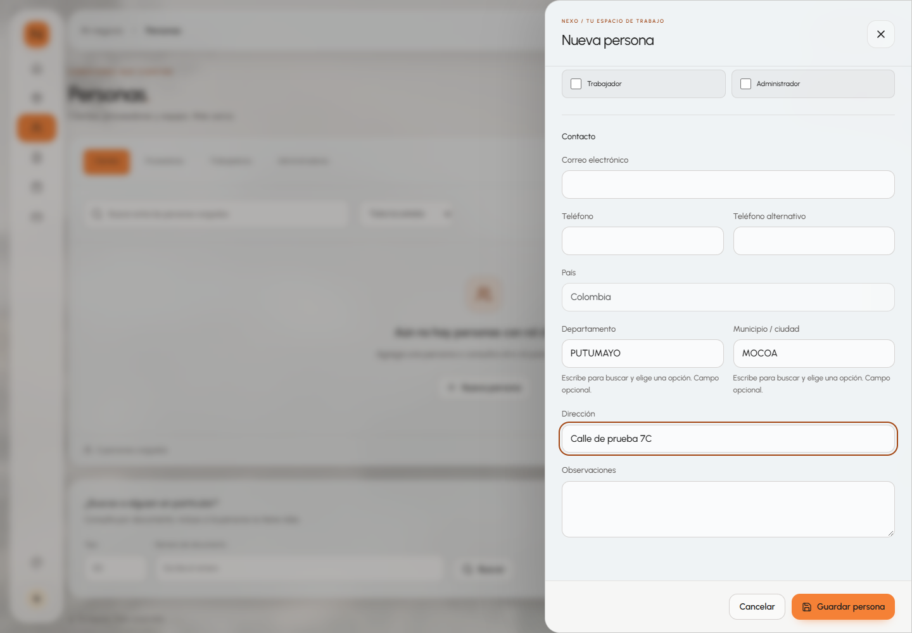
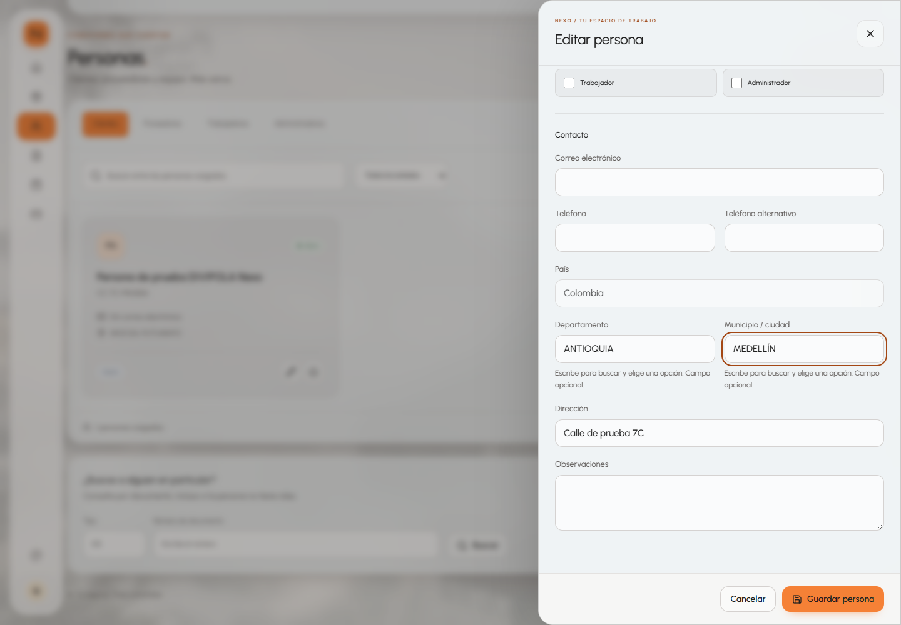

# Fase 7C: ubicaciones de personas con DIVIPOLA

Nexo permite seleccionar departamento y municipio desde un catálogo local del DANE. El formulario de Personas y el registro rápido de clientes en Nueva venta comparten `LocationSelector`. La dirección sigue siendo texto libre. Los campos geográficos conservan su carácter opcional.

## Fuente y versión

Fuente: [DIVIPOLA: códigos municipios, DANE](https://www.datos.gov.co/Mapas-Nacionales/DIVIPOLA-C-digos-municipios/gdxc-w37w), identificador Socrata `gdxc-w37w`.

La preparación del catálogo consulta los metadatos en `https://www.datos.gov.co/api/views/gdxc-w37w.json` y descarga `https://www.datos.gov.co/resource/gdxc-w37w.json` con selección explícita de columnas, orden por código y límite de 50.000 filas. Ese límite evita truncar los datos a las 1.000 filas predeterminadas de Socrata.

| Dato | Valor verificado |
| --- | --- |
| Descarga | 5 de noviembre de 2026, 13:53:51, America/Bogota |
| Actualización declarada por la fuente | 24 de enero de 2025, 20:44:32 UTC |
| Versión local | `gdxc-w37w-1737751472-aa3b6a773245` |
| Registros | 1.122 |
| Agrupaciones departamentales | 33: 32 departamentos y Bogotá D.C. |
| Tipos originales | 1.103 `Municipio`, 18 `Área no municipalizada`, 1 `Isla` |
| SHA-256 de las filas serializadas | `aa3b6a773245ca97f13d9664c3c914482099f94fa898e892237521f6fa70d7ad` |

El JSON contiene `metadata` y `municipios`. Cada registro conserva las cinco columnas API reales:

```json
{
  "cod_dpto": "05",
  "dpto": "ANTIOQUIA",
  "cod_mpio": "05001",
  "nom_mpio": "MEDELLÍN",
  "tipo_municipio": "Municipio"
}
```

Los códigos son cadenas: `05` y `05001` conservan sus ceros iniciales. Los nombres y tipos mantienen la escritura oficial. La aplicación incluye todas las entidades del conjunto, incluso las áreas no municipalizadas y la isla.

## Actualizar el catálogo

Desde la raíz, con Node.js 24:

```powershell
node scripts/update-divipola.mjs --update
node scripts/update-divipola.mjs --check
node --test scripts/divipola.test.mjs
```

`--update` necesita Internet únicamente durante la preparación. Comprueba las columnas en los metadatos, contrasta el total con `count(*)`, valida códigos de dos y cinco dígitos, prefijos departamento/municipio, nombres de departamento consistentes y ausencia de códigos municipales duplicados. También exige 33 agrupaciones y al menos 1.100 filas para detectar descargas incompletas. Si cambia la organización territorial, revisa estas condiciones antes de aceptar la nueva versión.

El script genera dos copias idénticas:

- `backend/src/main/resources/catalogos/divipola.json`, empaquetada dentro del JAR.
- `frontend/src/data/divipola.json`, incorporada por Vite al paquete JavaScript.

`--check` verifica ambas copias, los metadatos y el SHA-256 sin conectarse a Internet. Revisa el diff de datos y metadatos; si cambia el total oficial, ajusta las expectativas documentadas de las pruebas y ejecuta las suites. Reconstruye los dos servicios juntos para desplegar la misma versión:

```powershell
docker compose build facturacion-backend facturacion-frontend
docker compose up -d --no-deps --wait --wait-timeout 180 facturacion-backend facturacion-frontend
```

El funcionamiento normal del formulario y la validación del backend usan archivos locales. No requieren peticiones a datos.gov.co ni un contenedor adicional.

## Selección y accesibilidad

`frontend/src/locations.ts` prepara departamentos y municipios por código. Las búsquedas y el reconocimiento de nombres eliminan diacríticos, unifican mayúsculas y reducen espacios consecutivos. La búsqueda admite fragmentos; el reconocimiento de datos existentes exige una coincidencia única dentro del departamento.

`LocationSelector.tsx` muestra Colombia como país inicial. Los dos controles de búsqueda usan nombres visibles y códigos internos. El municipio está deshabilitado hasta seleccionar un departamento. Cambiar o limpiar el departamento borra el municipio anterior; volver a elegir el mismo departamento lo conserva. La opción «Sin especificar» permite conservar los campos opcionales.

Escribir un nombre no confirma una selección: el usuario debe elegir una opción de la lista. Un texto pendiente produce un error junto al campo e impide guardar. Las listas tienen roles `combobox`, `listbox` y `option`, estado expandido y opción activa. Admiten flechas, Inicio/Fin, Enter, Escape y Tab; Escape cierra la lista y mantiene el panel. Los controles reutilizan `Field`, los tokens de Nexo Design System y Urbanist.

`PersonEditor.tsx` conserva validaciones de identidad y correo, selección de roles, guardado parcial y confirmación de descarte. La revisión de `frontend/src` encontró un único formulario que ingresa ubicaciones: `PersonEditor`. `PersonSelector` lo reutiliza en Nueva venta. `People` también muestra ciudad y departamento en las tarjetas, sin ingresar datos geográficos.

## Backend y Cassandra

Se inspeccionaron `Persona`, `PersonaCommand`, `PersonaRequest`, `PersonaResponse`, `CassandraPersonaAdapter` y `PersonaCassandraEntity`. Los campos `pais`, `departamento` y `ciudad` siguen siendo `String`; el contrato JSON y las columnas Cassandra conservan su estructura.

El puerto `UbicacionCatalogoPort` permite validar ubicaciones sin acoplar `PersonaService` a archivos JSON. `DivipolaCatalogoAdapter` carga el recurso local una vez al crear el bean y verifica su estructura. Al crear una persona colombiana o modificar su ubicación, el servicio exige:

- Departamento reconocido si se proporciona un departamento o municipio.
- Municipio reconocido y único dentro del departamento seleccionado, si se proporciona municipio.
- Nombres oficiales al guardar una ubicación reconocida.

Una petición con `pais` omitido o vacío y campos geográficos se valida como colombiana. Así no se evita la validación retirando el país de la petición. Una ubicación completamente vacía es válida; también se admite departamento sin municipio. Los países extranjeros conservan sus campos de texto porque DIVIPOLA solo cubre Colombia.

La API devuelve HTTP 400 con `ProblemDetail` si falla la correspondencia. La validación ocurre antes de reservar un documento o escribir en Cassandra. Las pruebas HTTP cubren tanto POST como PUT. No se agregan columnas para códigos: esos códigos identifican las opciones en memoria y quedan disponibles en el catálogo para filtros futuros. Persistirlos requeriría una fase posterior con migración compatible.

## Personas existentes

Abrir el formulario o consultar una persona no modifica su ubicación. Si el usuario edita contacto, roles o dirección y conserva los tres campos geográficos, se guardan exactamente los valores anteriores, incluidos espacios, mayúsculas y `null`.

Los nombres antiguos que coinciden tras normalizar espacios, tildes y mayúsculas aparecen con su nombre oficial en el selector. Cambiar una selección guarda los nombres oficiales. La aplicación no usa coincidencias aproximadas ni elige un municipio sin un departamento inequívoco.

Si la ubicación no coincide, el formulario muestra los valores originales como solo lectura y pide revisarlos. El usuario puede conservarlos mientras edita otros datos o pulsar «Seleccionar ubicación de Colombia» para reemplazarlos con una selección del catálogo.

Las personas con país extranjero muestran su ubicación original. «Editar ubicación internacional» habilita región y ciudad como texto, con el país original visible. «Seleccionar ubicación de Colombia» inicia un cambio explícito al catálogo colombiano. No se añade un catálogo mundial.

## Archivos de esta fase

| Área | Archivos creados o modificados |
| --- | --- |
| Datos | Los dos `divipola.json` versionados |
| Preparación y verificación | `scripts/update-divipola.mjs`, `scripts/divipola.test.mjs`, `scripts/Test-DivipolaDocker.mjs` |
| Frontend | `locations.ts`, `LocationSelector.tsx`, `styles/locations.css`; integración en `PersonEditor.tsx`, `styles.css`, `package.json` |
| Backend | `UbicacionGeografica.java`, `UbicacionCatalogoPort.java`, `DivipolaCatalogoAdapter.java`; integración en `PersonaService.java` y `PersonaConfiguration.java` |
| Pruebas | `UbicacionesPersonaTests.java`, `locations.spec.ts`; ajustes de constructor y contrato de ubicación en `PersonaServiceTests.java` y `PersonaControllerTests.java` |
| Documentación | Este informe, capturas en `docs/capturas/fase7c/`, sección de README |

Los cambios previos de Druid en el árbol de trabajo se conservaron. Esta fase no modifica facturas, pagos, ingesta analítica, Compose ni volúmenes.

## Verificación

Las pruebas del catálogo se ejecutan sin Internet. Los casos Java usan repositorios en memoria y MockMvc; las pruebas del navegador interceptan las APIs de personas. Las capturas muestran personas ficticias y no corresponden a escrituras en Cassandra.

```powershell
node --test scripts/divipola.test.mjs
node scripts/update-divipola.mjs --check
node scripts/Test-DivipolaDocker.mjs
mvn -f backend/pom.xml --batch-mode --no-transfer-progress verify
cd frontend
npm run build
npm run test:locations
$env:UI_MUTATION_TESTS = '0'
npm run test:e2e
```

Las pruebas cubren catálogo y códigos, búsqueda con y sin tildes, dependencia y limpieza, nombres oficiales, rechazo de entradas pendientes e inválidas, creación y edición, datos antiguos, nulos, extranjeros, Nueva venta, descarte y teclado. El navegador bloquea datos.gov.co y comprueba que el formulario no intenta consultarlo.

El script `Test-DivipolaDocker.mjs` envía tres POST inválidos a la API desplegada: municipio de otro departamento en ambos sentidos y municipio sin departamento con país vacío. Exige HTTP 400 y consulta después el documento aleatorio, que debe responder HTTP 404. No actualiza personas ni ejecuta operaciones sobre facturas o pagos. Usa `NEXO_ORIGIN` si el frontend tiene otra URL.

| Comprobación | Resultado |
| --- | --- |
| Catálogo local | 2 pruebas aprobadas; copias y SHA-256 coinciden |
| Maven local (Java 22, destino 21) y construcción Docker (Java 21) | 122 casos: 117 aprobados, 5 omitidos, sin fallos |
| API desplegada | 3 rechazos HTTP 400 y consulta HTTP 404, sin crear ni reservar persona |
| Compilación frontend | TypeScript y Vite correctos, también durante la construcción Docker |
| Suite completa de navegador | 138 casos: 132 aprobados, 6 omitidos; escritorio, tableta y móvil; sin fallos |
| Selector sobre el despliegue final | 39 de 39 aprobados, incluidos Enter sin coincidencias y conservación del municipio al repetir departamento |

Los cinco casos Java omitidos pertenecen a `MySqlFacturaIntegrationTests`, que requiere activación explícita con `app.mysql.integration=true`. Esta fase conserva esa condición y usa los contratos H2 de persistencia en la suite habitual. Las pruebas de interfaz que escriben en las bases reales también se mantienen desactivadas con `UI_MUTATION_TESTS=0`.

Los 39 casos de DIVIPOLA (13 por tamaño de pantalla) forman parte de la suite del navegador. Los seis omitidos son los dos casos de `records.spec.ts` repetidos en los tres tamaños; requieren `UI_MUTATION_TESTS=1` y escriben en las bases reales. La regresión aprobada incluye productos, personas, roles, ventas, facturas, créditos, pagos simulados, temas y navegación. Las consultas de dashboard y las verificaciones de rutas e imágenes usan las APIs reales en modo lectura.

Al terminar, los doce contenedores están en ejecución y saludables: frontend, backend, MongoDB, Cassandra, MySQL y los siete servicios de Druid (`druid-router`, `druid-broker`, `druid-historical`, `druid-middlemanager`, `druid-coordinator`, `druid-metadata`, `druid-zookeeper`). Se reconstruyeron y actualizaron únicamente frontend y backend. Se conservaron los servicios, puertos y volúmenes existentes.

Las evidencias de ejecución quedan en `target/fase7c-e2e.log`, `target/fase7c-locations-final.log`, `target/fase7c-api-final.log`, `target/fase7c-docker-build-final.log`, `target/fase7c-frontend-build-final.log` y `target/fase7c-docker-state.json`, ignoradas por Git. Los reportes Java locales están en `backend/target/surefire-reports/`. Las capturas de esta entrega sí quedan en `docs/capturas/fase7c/`. No se hicieron commits ni push.

## Capturas

Creación de una persona con departamento y municipio seleccionados:



Edición de una persona y cambio de ubicación:


