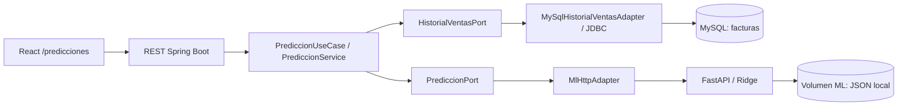

# Fase 8 · Predicción de valor facturado

Nexo incorpora un servicio opcional que aprende del historial diario de MySQL y estima el valor que podría facturarse en los próximos 7 o 14 días. No estima recaudo: una factura a crédito cuenta en su fecha de emisión; sus abonos no son ventas adicionales.

La fase 8B añade un segundo modo, **Demostración**, con 90 días sintéticos y un modelo independiente. El modo inicial sigue siendo **Datos reales**. Las verificaciones originales de fase 8 se conservan más abajo como evidencia histórica; el procedimiento actualizado de demostración está al final de este informe.

La implementación se preparó en `feature/ml-prediccion-ventas`, desde `main` sin cambios pendientes. No se realizaron commits ni push. No se modificó `.env`, el esquema transaccional ni la configuración de Druid.

## Integración hexagonal



Los contratos de `application/prediction`, el puerto de entrada y el caso de uso usan solamente Java. JDBC, Spring, JSON y HTTP quedan en infraestructura. Python recibe fechas e importes agregados, sin credenciales MySQL, datos de personas, detalles ni pagos. No hay eventos ni entrenamientos automáticos al emitir facturas. La facturación funciona con ML deshabilitado o detenido.

## Datos y fechas

- Fuente: `SUM(total)` agrupado por día de `facturas.fecha_emision`.
- Las entidades existentes usan `Instant`; Hibernate y la sesión MySQL guardan UTC en `DATETIME(6)`.
- La consulta convierte UTC a `-05:00`, el desplazamiento de `America/Bogota` en el período admitido. No depende de que MySQL tenga cargadas tablas de zonas horarias.
- El filtro usa límites UTC del inicio y fin de días de Bogotá y conserva el uso del índice `ix_factura_fecha`. JDBC recibe `LocalDateTime` UTC para evitar conversiones adicionales por la zona del host.
- Se excluye hoy en Bogotá. Se consultan hasta 1.095 días completos y se rellenan ceros desde la primera fecha observada dentro de esa ventana hasta ayer. No se inventan facturas ni se extiende el historial antes de la primera fecha observada.
- El adaptador ejecuta una transacción de solo lectura y devuelve como máximo una fila por día; no materializa entidades ni hace joins con detalles o pagos.
- Mínimo: 56 observaciones diarias consecutivas, 14 días con ventas distribuidos en al menos 6 bloques semanales desde el inicio del historial, incluyendo al menos 4 bloques en el tramo de entrenamiento.
- Se rechazan duplicados, fechas desordenadas, huecos, fechas futuras e importes negativos o fuera de rango. Python exige que el último dato sea ayer en Bogotá.

Consulta productiva:

```sql
SELECT DATE(CONVERT_TZ(fecha_emision, '+00:00', '-05:00')) AS dia,
       SUM(total) AS total
FROM facturas
WHERE fecha_emision >= ? AND fecha_emision < ?
GROUP BY dia ORDER BY dia;
```

Los límites corresponden a medianoches de Bogotá convertidas a UTC. La consulta no cambia el esquema ni los registros existentes.

## Algoritmo y entrenamiento real

Se usa `sklearn.linear_model.Ridge(alpha=1.0)` con intercepto. Sus ocho variables son el tiempo transcurrido desde el inicio, dividido por 56, y siete indicadores del día de la semana. La penalización L2 reduce la inestabilidad de los coeficientes. Alpha es fijo; no se selecciona usando el conjunto de evaluación.

1. Validar calidad, continuidad, volumen y actividad.
2. Reservar cronológicamente los últimos 14 días.
3. Ejecutar `fit()` con los días anteriores y `predict()` sobre el período reservado.
4. Limitar los pronósticos negativos a cero y calcular los errores contra los importes reales.
5. Comparar con una referencia que repite la última semana conocida al inicio de la evaluación. Para la segunda semana se repiten esos mismos siete valores: no se utilizan las ventas reales de la primera semana reservada.
6. Ejecutar un segundo `fit()` con todo el historial válido.
7. Guardar coeficientes, intercepto, historial agregado, fecha UTC de entrenamiento, período, conteo, métricas y versión `ridge-diaria-v1`.

La inferencia reconstruye Ridge con esos parámetros y llama a `predict()` para los próximos días desde hoy en Bogotá. No vuelve a entrenar al consultar. No hay fórmulas de crecimiento fijo, separación aleatoria, redes neuronales ni servicios externos de IA.

### Métricas

| Campo | Interpretación |
| --- | --- |
| `mae` | Promedio de diferencias absolutas diarias, en COP |
| `wape` | `100 × suma de errores absolutos / suma de valores reales` |
| `maeReferencia`, `wapeReferencia` | Las mismas medidas para la referencia semanal |
| `mejoraReferencia` | Reducción porcentual del error absoluto respecto a la referencia; puede ser negativa |
| Fechas de evaluación | Permiten comprobar que entrenamiento y evaluación no se solapan |

Si el total real de evaluación es cero, WAPE es `null`. Si la referencia tiene error cero, la mejora porcentual es `null`. MAE sigue definido con ventas cero. Las métricas no son probabilidades ni intervalos de confianza. Ridge puede superar o empeorar la referencia; la interfaz muestra ambos resultados.

### Dinero y persistencia

JDBC convierte `BigDecimal` con dos decimales a texto. Todas las cantidades monetarias del contrato ML son cadenas decimales, incluidos los totales, promedios y MAE. Python valida esas cadenas con Pydantic y `Decimal`; solamente el ajuste y la inferencia utilizan `float64` de NumPy. Las salidas se redondean a centavos con `ROUND_HALF_UP`; total y promedio se calculan con `Decimal` a partir de las predicciones redondeadas. React usa las utilidades existentes de centavos `BigInt` y solo aproxima números para coordenadas gráficas.

Se admite hasta `1000000000000.00` COP por día para mantener una resolución adecuada en `float64`. Este límite pertenece al módulo ML; no cambia los límites de la facturación existente. El cálculo predictivo es aproximado y no constituye un registro contable.

El artefacto es `/data/ridge-v1.json`, generado exclusivamente por el servicio. Se escribe primero un archivo temporal y se reemplaza atómicamente. No se carga `pickle` ni `joblib`, no hay endpoint de carga de archivos y un artefacto corrupto obliga a entrenar de nuevo. Un error de entrenamiento o persistencia conserva el modelo anterior. El servicio debe ejecutarse con **un worker**, como establece el Dockerfile; el bloqueo es por proceso y no implementa coordinación distribuida.

## Contratos REST

Spring expone administración local, consistente con `ProblemDetail` del proyecto:

| Método y ruta | Resultado |
| --- | --- |
| `GET /api/predicciones/estado` | Habilitación, disponibilidad, modelo, entrenamiento en curso y última fecha; responde 200 incluso deshabilitado o sin conexión |
| `POST /api/predicciones/entrenar` | Entrenamiento síncrono solicitado por el usuario; responde 200 con metadatos al completarse |
| `GET /api/predicciones/ventas?horizonte=7` | Pronóstico de 7 días; también admite 14 |

Una predicción incluye `horizonte`, `estado`, `predicciones`, `totalProyectado`, `promedioDiario`, `historico` y `modelo`. Cada día tiene `fecha` ISO y `total` como cadena. El modelo contiene las métricas y todas las fechas de evaluación y entrenamiento.

Errores con `status`, `detail` y `codigo`:

| HTTP | Códigos |
| --- | --- |
| 400 | `HORIZONTE_INVALIDO`, `DATOS_INVALIDOS` |
| 409 | `MODELO_NO_ENTRENADO`, `ENTRENAMIENTO_EN_CURSO` |
| 422 | `DATOS_INSUFICIENTES` |
| 503 | `DESHABILITADO`, `SERVICIO_NO_DISPONIBLE` |

Cuando el historial del modelo termina antes de ayer, estado e inferencia indican `MODELO_DESACTUALIZADO`; se permiten predicciones desde hoy y se recomienda reentrenar. No hay refresco automático ni detección de cambios retroactivos en días ya entrenados.

FastAPI expone las rutas internas `/health`, `/estado`, `/entrenar` y `/ventas`. Sus contratos usan los mismos nombres. `/entrenar` acepta `{"observaciones":[{"fecha":"2026-01-01","total":"1234.50"}]}`. Un cuerpo con menos de 56 días válidos se rechaza; el ejemplo solo ilustra la estructura.

El bloqueo Java evita consultas y entrenamientos simultáneos desde esa instancia; Python también protege el ajuste. El timeout HTTP es 10 segundos, configurable hasta 15 para quedar por debajo de los 20 segundos del cliente web. Un timeout no cancela un ajuste que ya comenzó: consulta el estado antes de reintentar.

No hay autenticación en Nexo. Los puertos de Spring y Nginx están ligados a `127.0.0.1`; Python no publica puerto. Estos endpoints no deben exponerse por túneles, proxies públicos o cambios de binding sin añadir autenticación y autorización.

## Docker y ejecución

El perfil `ml` agrega únicamente `facturacion-ml`, en la red `facturacion-interna`, con memoria máxima de 384 MiB, usuario sin privilegios y un healthcheck HTTP. El volumen independiente `ml-model-data` conserva el modelo. No hay nueva base de datos ni dependencia de arranque ML en Spring. Druid y los volúmenes de negocio conservan su configuración.

Variables, también documentadas en `.env.example`:

| Variable | Predeterminado |
| --- | --- |
| `ML_ENABLED` | `false` |
| `ML_BASE_URL` | `http://facturacion-ml:8000` dentro de Compose; `http://localhost:8000` para Java local |
| `ML_HTTP_TIMEOUT` | `PT10S`, máximo `PT15S` |
| `ML_MODEL_DIR` | `/data` dentro de Python Docker |

No hace falta modificar el `.env` existente. Desde la raíz, en PowerShell, con las bases habituales ya iniciadas:

```powershell
docker compose config --quiet
docker compose --profile ml config --quiet
docker compose --profile ml build facturacion-ml facturacion-backend facturacion-frontend
docker compose --profile ml up -d --no-deps --no-build --wait facturacion-ml
$env:ML_ENABLED = 'true'
docker compose up -d --no-deps --no-build --wait --wait-timeout 180 facturacion-backend facturacion-frontend
Invoke-RestMethod http://localhost:8080/api/predicciones/estado
# Este POST entrena únicamente si el historial real cumple los mínimos.
Invoke-RestMethod -Method Post http://localhost:8080/api/predicciones/entrenar
Invoke-RestMethod 'http://localhost:8080/api/predicciones/ventas?horizonte=7'
```

Abre `http://localhost:5173/predicciones`. Para una instalación que todavía no está iniciada, usa primero el arranque normal del README; los comandos `--no-deps` anteriores actualizan solo ML y las aplicaciones.

Para volver a ML deshabilitado y conservar todos los datos:

```powershell
$env:ML_ENABLED = 'false'
docker compose up -d --no-deps --no-build --wait --wait-timeout 180 facturacion-backend
docker compose --profile ml stop facturacion-ml
Remove-Item Env:ML_ENABLED
```

No se debe eliminar ningún volumen. `--no-deps` evita reiniciar o recrear Cassandra, MongoDB, MySQL o Druid.

### Desarrollo aislado

```powershell
cd services/ml-api
python -m venv .venv
.\.venv\Scripts\python.exe -m pip install -r requirements-dev.txt
.\.venv\Scripts\python.exe -m pytest -q
# Servicio privado en localhost; no contiene datos de pruebas por defecto.
.\.venv\Scripts\python.exe -m uvicorn app.main:app --host 127.0.0.1 --port 8000
```

Para Java local se usan `ML_ENABLED=true` y `ML_BASE_URL=http://127.0.0.1:8000`, además de las conexiones de negocio habituales.

## Interfaz y evidencias

La pantalla comparte Urbanist, tokens de color naranja, superficies glass, componentes, barra lateral y header de Nexo. Tiene selector de 7/14 días, entrenamiento explícito, actualización, indicadores reales, series con línea sólida y discontinua, fechas, leyenda y tabla accesible con todos los importes. La zona futura está sombreada y no representa un intervalo estadístico. Se respeta el movimiento reducido del sistema existente.

Las capturas de [escritorio claro](capturas/fase8/predicciones-light-desktop.png), [escritorio oscuro](capturas/fase8/predicciones-dark-desktop.png), [tablet](capturas/fase8/predicciones-light-tablet.png) y [móvil](capturas/fase8/predicciones-dark-mobile.png) provienen de Playwright con contratos simulados. **Sus cifras son datos sintéticos de prueba, no pronósticos sobre las facturas del usuario.** No se insertaron en las bases ni en el volumen ML de producción.

Las capturas [modelo pendiente](capturas/fase8/predicciones-real-pendiente.png) e [historial insuficiente](capturas/fase8/predicciones-real-insuficiente.png) corresponden al sistema Docker real, sin interceptar HTTP. Muestran la situación del historial existente al verificar esta fase.

## Demostración académica

1. Iniciar Nexo sin ML y mostrar que las operaciones y `/api/health` siguen disponibles.
2. Activar el perfil y comprobar salud y `/api/predicciones/estado`.
3. Explicar la consulta de agregación, la diferencia entre facturación y recaudo y el corte UTC/Bogotá.
4. Solicitar entrenamiento desde la pantalla. Si faltan días, mostrar el rechazo explícito; no insertar facturas ficticias para saltar el requisito.
5. Con historial suficiente, comparar 7 y 14 días, abrir la tabla exacta y explicar MAE, WAPE y referencia semanal.
6. Para demostrar el ajuste aun sin suficiente historia real, ejecutar pytest y la integración Java–Python aislada. Las pruebas verifican dos llamadas `fit()`, corte cronológico, inferencia, persistencia y recuperación.
7. Detener solo ML y mostrar que facturas, productos, personas y pagos continúan accesibles.

## Limitaciones

Modelo lineal con día de semana: no incorpora festivos, promociones, estacionalidad anual, inventario, productos ni información externa. Un único período de evaluación no garantiza rendimiento futuro. Historias intermitentes pueden generar errores altos; se muestra la comparación incluso si Ridge pierde. No se generan intervalos de confianza.

El modelo se actualiza manualmente, admite hasta tres años diarios y usa un worker. Una versión posterior podría añadir validación temporal con múltiples ventanas y selección de regularización exclusivamente dentro del entrenamiento. Esas mejoras requieren más historia y no se simulan en esta entrega.

## Inventario de cambios

- `services/ml-api/`: Dockerfile, dependencias, FastAPI, Ridge, persistencia y pytest.
- `application/prediction/`, `application/port/PrediccionUseCase.java`, `application/usecase/PrediccionService.java`: contratos y lógica independiente de frameworks.
- `infrastructure/adapter/output/mysql/MySqlHistorialVentasAdapter.java`: agregación JDBC de solo lectura.
- `infrastructure/adapter/output/ml/MlHttpAdapter.java`, `infrastructure/config/Ml*.java`: HTTP y configuración.
- `infrastructure/adapter/input/rest/PrediccionController.java`: REST y errores.
- Pruebas Java `PrediccionServiceTests`, `HistorialVentasTests`, `MlHttpAdapterTests`, `MlPythonIntegrationTests` y `PrediccionControllerTests`.
- Frontend: `pages/Predictions.tsx`, `predictions.ts`, `styles/predictions.css`, `tests/predictions.spec.ts`, y enlaces en `App.tsx`, `types.ts`, `styles.css`.
- `docker-compose.yml`, `.env.example`, `.gitignore`, configuración Spring, README y este informe.

## Verificación ejecutada · 12 de noviembre de 2026

| Verificación | Resultado observado |
| --- | --- |
| Python 3.12 / pytest | **12 aprobadas**; una advertencia de deprecación de Starlette/AnyIO, sin errores |
| Java 21 / Maven `clean verify` dentro del Dockerfile | **159 pruebas: 153 aprobadas, 6 omitidas, 0 fallos y 0 errores**; imagen construida correctamente |
| Java–FastAPI real, aislado en localhost:18080 | **1 integración aprobada**, entrenando y consultando 7/14 días; junto a 3 pruebas REST, 4 aprobadas en esa ejecución |
| Suite completa Playwright | **209 aprobadas, 7 omitidas, 0 fallos**, escritorio/tablet/móvil; 10,4 minutos |
| Repetición final de la suite ML y capturas | **12 aprobadas** en los tres tamaños y ambos temas |
| Frontend TypeScript/Vite | Compilación de producción aprobada, tanto local como en Docker |
| DIVIPOLA | 2 pruebas Node aprobadas y copias/SHA-256 verificados |
| Compose normal y `--profile ml` | Ambas configuraciones válidas; las tres imágenes nuevas se construyeron |
| Salud Docker final | Backend, frontend y ML saludables; Python con 384 MiB y `PortBindings={}` |
| Protección de infraestructura | Los 10 contenedores de bases y Druid conservaron ID, instante de arranque y contador de reinicios |

Las cinco pruebas Java de CRUD contra MySQL real se omitieron para no insertar datos ficticios en las bases persistentes. La sexta omisión es la integración Python optativa, que sí se ejecutó por separado contra un servicio y artefacto de pruebas aislados. En Playwright se omitieron seis ejecuciones de escrituras reales (dos casos por tamaño) y un caso táctil que no aplica a escritorio. Las demás escrituras de interfaz se interceptaron en memoria.

Las comprobaciones SQL reales fueron de solo lectura. Había **7 facturas**, agrupadas en **2 fechas con actividad**; el primer día observado fue el 5 de noviembre y el corte de entrenamiento fue el 11 de noviembre de 2026: **7 días completos**, insuficientes para entrenar. No se fabricó un modelo con esos datos.

Se comprobaron tres escenarios contra Spring en Docker:

| Escenario | Respuestas verificadas |
| --- | --- |
| Python detenido y `ML_ENABLED=false` | Salud, facturas, productos y clientes: 200. Estado ML: 200, `DESHABILITADO`. Predicción: 503 |
| Python saludable y `ML_ENABLED=true` | Estado: 200, disponible y pendiente. Entrenamiento: 422 `DATOS_INSUFICIENTES`. Inferencias 7/14: 409 `MODELO_NO_ENTRENADO`. Horizonte 8: 400 |
| Python detenido y `ML_ENABLED=true` | Salud y consultas de negocio: 200. Estado: 200, `SERVICIO_NO_DISPONIBLE`. Predicción: 503 controlado |

Las consultas de facturación devolvieron las mismas 7 facturas en los tres escenarios. Después se reinició solo ML y quedó saludable y disponible. **Estado de entrega:** backend con ML habilitado mediante variable temporal de Compose, frontend actualizado en `http://localhost:5173/predicciones`, modelo real pendiente. Los archivos mantienen ML deshabilitado por defecto; `.env` no se editó.

No se ejecutaron escrituras de facturación sobre las bases persistentes ni se probó un pronóstico productivo exitoso, porque faltan datos. El entrenamiento exitoso, la inferencia y la recuperación se demostraron exclusivamente con datos sintéticos aislados mediante pytest y la integración Java–Python. No se cambió configuración, volumen ni contenedor de las bases o Druid.

### Comandos de pruebas reproducibles

Desde la raíz:

```powershell
# Python; instala primero requirements-dev.txt en el entorno virtual indicado arriba.
Push-Location services/ml-api
.\.venv\Scripts\python.exe -m pytest -q --junitxml=../../target/ml-pytest.xml
Pop-Location

# Suite ordinaria Java: H2 y dobles, sin escrituras en las bases reales.
.\backend\mvnw.cmd -f backend/pom.xml --batch-mode --no-transfer-progress verify

# El Dockerfile Java también ejecuta clean verify con JDK 21.
docker compose build facturacion-backend facturacion-frontend

# Desde frontend/, con Vite iniciado en localhost:5174:
# npm run dev -- --port 5174 --strictPort
Push-Location frontend
$env:UI_BASE_URL = 'http://127.0.0.1:5174'
$env:UI_MUTATION_TESTS = '0'
$env:PROVIDER_READ_ONLY_TESTS = '1'
npm run test:e2e
npx playwright test tests/predictions.spec.ts
Pop-Location

node --test scripts/divipola.test.mjs
node scripts/update-divipola.mjs --check
```

Para reproducir la integración Java–Python en una terminal separada, sin utilizar el volumen de producción:

```powershell
# Terminal 1, desde la raíz:
New-Item -ItemType Directory -Force target | Out-Null
$env:ML_MODEL_DIR = Join-Path (Resolve-Path target) 'ml-integration'
Push-Location services/ml-api
.\.venv\Scripts\python.exe -m uvicorn app.main:app --host 127.0.0.1 --port 18080

# Terminal 2, desde la raíz:
.\backend\mvnw.cmd -f backend/pom.xml --batch-mode --no-transfer-progress '-Dtest=MlPythonIntegrationTests' '-Dapp.ml.integration=true' test
```

Artefactos locales de la verificación, excluidos de Git: `target/ml-pytest.xml`, `target/fase8-docker-build-final.log`, `target/fase8-frontend-build-final.log`, `target/fase8-java-python.log`, `target/fase8-ui.log`, `target/fase8-ui-ml-final.log`, `target/fase8-live.jsonl` y las listas `target/fase8-containers-before.txt` / `target/fase8-containers-after.txt`. Los informes Java quedan en `backend/target/surefire-reports/`. Las capturas nuevas se conservan en `docs/capturas/fase8/`; las de fases anteriores regeneradas por la suite se restauraron a su versión original, con copia de las salidas generadas en `target/fase8-regenerated-captures/`.

## Fase 8B · Modo demostración

### Cómo utilizar ambos modos

En `http://localhost:5173/predicciones`, el selector **Origen de los datos** permite elegir:

1. **Datos reales**: conserva los endpoints, la consulta MySQL, las reglas de actividad y el mínimo de 56 días. Si la historia no alcanza ese mínimo, el entrenamiento devuelve 422. No se sustituyen esas observaciones por datos sintéticos.
2. **Demostración**: pulsa **Entrenar modelo** para generar 90 días, ajustar Ridge, evaluar los últimos 14 días y calcular un pronóstico. Selecciona 7 o 14 días para cambiar el horizonte. **Actualizar predicción** consulta el modelo existente sin volver a entrenarlo.

La demostración muestra **Datos simulados** al estar pendiente, durante el entrenamiento y al presentar resultados. Los indicadores, la leyenda, la tabla y la evaluación identifican su procedencia. La gráfica muestra los 90 días sintéticos y las predicciones obtenidas por Ridge. Cambiar a Datos reales limpia los resultados demo; regresar a Demostración recupera su propio modelo sin modificar el real. La selección se bloquea durante solicitudes para evitar cruces entre respuestas.

### Generación reproducible y aprendizaje

`services/ml-api/app/demo.py` utiliza `numpy.random.default_rng(20261112)`. Para la misma fecha de corte y semilla genera los mismos 90 días consecutivos, terminando ayer en Bogotá:

- Base de 280.000 COP y tendencia de 0,2 % diario sobre la base: 17,8 % de incremento entre el primer y último día.
- Factores de lunes a domingo: 0,85; 0,95; 1,00; 1,04; 1,15; 1,35; 0,55.
- Fluctuación normal con desviación de 6,5 % y semilla fija.
- Cuatro jornadas de menor actividad, separadas por 23 días y con factor 0,35.
- Importes no negativos, redondeados a centavos y comunicados como cadenas decimales en COP.

La tendencia anterior genera **historia de entrada**, no pronósticos. La fecha de corte avanza con el calendario; reproducibilidad significa misma semilla y misma fecha de corte. El historial exacto también queda guardado con el modelo.

Se invoca el mismo `Forecaster.train()` usado por Datos reales: `fit()` con 76 días, evaluación con `predict()` sobre los últimos 14, cálculo real de MAE/WAPE y referencia semanal, y un segundo `fit()` con los 90 días. Las consultas futuras usan `Ridge.predict()`. No hay métricas fijas ni predicciones precalculadas.

### Aislamiento y arquitectura

```text
React: modo Demostración
  → DemostracionController
  → DemostracionUseCase / DemostracionService
  → DemostracionPort
  → MlHttpAdapter /demo/...
  → generador Python → Forecaster.train() → Ridge
```

`DemostracionService` no recibe `HistorialVentasPort`, repositorios ni credenciales. Python no tiene acceso a las bases. Este flujo no consulta facturas ni modifica MySQL, MongoDB, Cassandra o Druid. El flujo real sigue usando su puerto de lectura existente.

| Información | Datos reales | Demostración |
| --- | --- | --- |
| Entrada | Totales diarios MySQL | Generador Python, 90 días |
| Archivo | `/data/ridge-v1.json` | `/data/demostracion/ridge-v1.json` |
| Estado y bloqueo | Instancia real | Instancia demo independiente |
| Origen del artefacto | `REAL` | `DEMOSTRACION` |
| Contrato público | Contratos existentes | Respuesta marcada con `modo` y `datosSimulados` |

Ambos directorios pertenecen al volumen ML existente; no se elimina, migra ni reinicializa ningún volumen. El archivo demo se escribe atómicamente en su propio directorio. Un artefacto de otro modo se rechaza al cargarlo, incluso si alguien lo copia a la ruta equivocada. Los artefactos antiguos sin marca se reconocen únicamente como reales. Reentrenar un modo no cambia el otro.

### Contratos y habilitación local

Se conservan las tres rutas reales y se añaden:

| Ruta Spring | Ruta privada FastAPI | Uso |
| --- | --- | --- |
| `GET /api/predicciones/demo/estado` | `GET /demo/estado` | Estado independiente |
| `POST /api/predicciones/demo/entrenar` | `POST /demo/entrenar` | Generar historia y entrenar; sin cuerpo de datos del usuario |
| `GET /api/predicciones/demo/ventas?horizonte=7` | `GET /demo/ventas?horizonte=7` | Inferencia de 7 o 14 días |

Las respuestas exitosas demo tienen este contenedor explícito:

```json
{
  "modo": "DEMOSTRACION",
  "datosSimulados": true,
  "resultado": { "horizonte": 7, "estado": "LISTO" }
}
```

`resultado` contiene el contrato completo de estado, metadatos de entrenamiento o predicción ya descrito. El ejemplo abreviado solo ilustra la envoltura. El adaptador Java y React verifican los marcadores antes de utilizar sus datos. El adaptador real rechaza respuestas demo. Los errores siguen usando `ProblemDetail`; `DEMO_DESHABILITADA` responde 503 y el estado deshabilitado responde 200.

La variable nueva **`ML_DEMO_ENABLED=false`** es el valor predeterminado de Spring, Python y Compose. Para acceder desde React deben activarse tanto `ML_ENABLED` como `ML_DEMO_ENABLED`; el servicio Python también exige el segundo flag. La aplicación conserva sus bindings de localhost y Python sigue sin publicar puertos. Esta función carece de autenticación y solo debe activarse en el entorno académico local; no se debe publicar por túneles o proxies externos.

No es necesario editar `.env`. Con las bases ya iniciadas, actualiza exclusivamente los tres servicios de aplicación:

```powershell
$env:ML_ENABLED = 'true'
$env:ML_DEMO_ENABLED = 'true'
docker compose --profile ml config --quiet
docker compose --profile ml build facturacion-ml facturacion-backend facturacion-frontend
docker compose --profile ml up -d --no-deps --no-build --wait --wait-timeout 120 facturacion-ml
docker compose up -d --no-deps --no-build --wait --wait-timeout 180 facturacion-backend facturacion-frontend
```

Estos comandos de actualización afectan únicamente a ML, backend y frontend. `--no-deps` conserva los contenedores de las bases y Druid, así como sus volúmenes.

Comprobación manual:

```powershell
Invoke-RestMethod http://localhost:8080/api/predicciones/demo/estado
Invoke-RestMethod -Method Post http://localhost:8080/api/predicciones/demo/entrenar
Invoke-RestMethod 'http://localhost:8080/api/predicciones/demo/ventas?horizonte=14'
# El estado real permanece independiente:
Invoke-RestMethod http://localhost:8080/api/predicciones/estado
```

Para deshabilitar solo la demostración, establece `$env:ML_DEMO_ENABLED='false'` y actualiza esos mismos servicios conservando los volúmenes. El artefacto demo queda guardado para una activación posterior. Al cerrar PowerShell, las variables temporales dejan de aplicarse a comandos futuros; la configuración del contenedor en ejecución permanece hasta su siguiente actualización.

### Pruebas de 8B

La suite Python verifica generación reproducible, continuidad, actividad semanal, días de baja actividad, `fit()` de 76 y 90 observaciones, cálculo independiente de las métricas, horizontes 7/14, persistencia, deshabilitación predeterminada y rechazo de artefactos cruzados. Un caso compara byte por byte un artefacto real antes y después de entrenar demo.

Las pruebas Java verifican la configuración, la separación de rutas y puertos, bloqueo de duplicados, errores, marcas de origen y el flujo REST → caso de uso → FastAPI real. Este último utiliza H2 y dobles y comprueba que las peticiones demo no invocan el puerto histórico ni los clientes MongoDB/Cassandra.

Playwright cubre ambos modos en tres tamaños: entrenamiento explícito, métricas, tabla, horizontes, bloqueo durante solicitudes, cambios de modo, errores y respuestas sin procedencia. Sus contratos simulados solo se usan dentro de las pruebas; la aplicación usa el generador y Ridge reales.

Para ejecutar la integración Python aislada usa `ML_MODEL_DIR` dentro de `target/`, `ML_DEMO_ENABLED=true` y el puerto 18080. Con ese servicio iniciado:

```powershell
.\backend\mvnw.cmd -f backend/pom.xml --batch-mode --no-transfer-progress '-Dapp.ml.integration=true' verify
```

La suite normal mantiene las integraciones externas omitidas. `DemostracionFlowIntegrationTests` admite además `-Dapp.ml.ui-script=<ruta absoluta a frontend/scripts/test-ml-demo-live.mjs>` para verificar Chrome contra Spring y Python aislados, con Vite iniciado en 5174. Este navegador reenvía HTTP al Spring de pruebas, sin fabricar cuerpos ni predicciones.

Para repetir el recorrido completo contra la aplicación Docker actualizada:

```powershell
Push-Location frontend
node scripts/test-ml-demo-live.mjs
Pop-Location
```

Ese script entrena solo el modelo demo, comprueba 90 observaciones y ambos horizontes, recorre la tabla, captura temas claro/oscuro y móvil, y compara el estado real antes y después. No crea registros de negocio. Guarda evidencias en `target/fase8b-live-ui.json` y `docs/capturas/fase8b/`.

### Resultados verificados de 8B · 12 de noviembre de 2026

| Prueba | Resultado |
| --- | --- |
| Python, suite completa | **18 aprobadas**, una advertencia de deprecación de Starlette/AnyIO |
| Java 21 en Docker, `clean verify` final | **168 pruebas: 159 aprobadas, 9 omitidas, 0 fallos y 0 errores** |
| Integraciones optativas reales | **4 casos aprobados** en ejecuciones separadas: dos del adaptador, REST Spring completo y navegador React → Spring → Python |
| Playwright, suite completa con dos workers | **214 aprobadas, 1 fallo por espera de 8 segundos en catálogo/tablet, 7 omitidas** |
| Repetición del único fallo, con un worker | **1 aprobada**; el catálogo no se modificó. Las 215 pruebas no omitidas quedaron verificadas entre ambas ejecuciones |
| Pruebas específicas de ambos modos | **18 aprobadas** en escritorio, tablet y móvil |
| Navegador sobre Docker local | Entrenamiento Ridge de 90 días, métricas, tabla, horizontes 7/14, temas y móvil aprobados; estado real sin cambios |
| Recuperación desde otro proceso Python del contenedor ML | Modelo demo cargado del JSON, 90 observaciones y el mismo total previsto a 14 días |
| Frontend y Compose | TypeScript/Vite y las tres imágenes construidas; configuración normal y perfil ML válidos |

Las nueve omisiones Java corresponden a cinco pruebas de escritura sobre MySQL real, dos integraciones de adaptador y dos de flujo/navegador que requieren habilitación explícita. Estas cuatro integraciones ML sí se ejecutaron aparte. Las siete omisiones Playwright conservan las razones originales: seis escrituras reales deshabilitadas y una prueba táctil no aplicable a escritorio.

El primer intento Java detectó una ambigüedad de constructor en la configuración, corregida con `@ConstructorBinding`. Un contrato simulado incompleto también se corrigió antes de la construcción final. Esos resultados preliminares no se presentan como pruebas aprobadas. El único fallo de la suite completa de interfaz fue una espera de catálogo bajo ejecución paralela; su repetición secuencial pasó sin modificar módulos ajenos a ML.

La aplicación quedó actualizada y saludable en `http://localhost:5173/predicciones`, con `ML_ENABLED=true` y `ML_DEMO_ENABLED=true` aplicados temporalmente a Compose. El usuario autorizó actualizar únicamente los tres contenedores de aplicación. MySQL, MongoDB, Cassandra y los siete contenedores Druid conservaron sus identificadores, instantes de arranque y contadores de reinicios. Ningún volumen se eliminó ni reinicializó; `.env` se conservó.

El volcado de solo lectura de `facturas`, `factura_detalles` y `pagos` produjo exactamente el mismo SHA-256 antes y después de entrenar demo: `6cbe00619f114529347ce34725342fc605b6038af89a5c32ff3693cbe8aed81e`. El modo real siguió sin artefacto y su entrenamiento devolvió **422** por los siete días de historial; el artefacto demo quedó entrenado en su propio directorio. Las pruebas aisladas también verificaron que un artefacto real previamente entrenado conserva exactamente sus bytes tras entrenar demo.

Con corte al 11 de noviembre de 2026 y la semilla fija, el navegador sobre Docker calculó:

| Medida de demostración | Resultado calculado |
| --- | --- |
| Historia sintética | 14 de agosto–11 de noviembre, 90 días |
| Total histórico simulado | 26.450.612,70 COP |
| MAE Ridge | 30.842,20 COP |
| WAPE Ridge | 10,12 % |
| MAE referencia | 28.567,92 COP |
| WAPE referencia | 9,37 % |
| Mejora respecto a la referencia | −7,96 %; Ridge tuvo mayor error |
| Proyección a 7 días | 2.237.233,79 COP |
| Proyección a 14 días | 4.500.407,87 COP |

Estos importes son resultados reales del algoritmo sobre **datos simulados**. No representan ventas auténticas y no se utilizan como valores fijos de la API. Cambiar la fecha de corte, semilla, generador o algoritmo puede cambiar los resultados. El error mayor que la referencia se muestra expresamente; no se ajustó la demostración para ocultarlo.

Capturas generadas por la aplicación Docker con respuestas reales de Ridge: [escritorio claro](capturas/fase8b/demo-light-desktop.png), [escritorio oscuro](capturas/fase8b/demo-dark-desktop.png), [móvil claro](capturas/fase8b/demo-light-mobile.png) y [móvil oscuro](capturas/fase8b/demo-dark-mobile.png).

Evidencias locales excluidas de Git: `target/fase8b-pytest.xml`, `target/fase8b-docker-verified.log`, `target/fase8b-ui-full.log`, `target/fase8b-ui-retry.log`, `target/fase8b-ui-ml.log`, `target/fase8b-spring-python.log`, `target/fase8b-browser-final.log`, `target/fase8b-live-ui.json`, `target/fase8b-model-isolation.json`, `target/fase8b-protected-after.txt` y los respaldos/huellas iniciales de `target/fase8b-baseline/`. Las 27 capturas antiguas regeneradas por la suite se devolvieron a sus copias iniciales de esta fase, conservando también las salidas nuevas dentro de `target/`.

Archivos de 8B: generador `app/demo.py`, ampliaciones de `app/model.py` y `app/main.py`, pruebas `tests/test_demo.py`; puertos `DemostracionPort`/`DemostracionUseCase`, caso de uso `DemostracionService`, `DemostracionController`, envoltura explícita en `Prediccion`, adaptador y configuración ML; nuevas pruebas Java de servicio, controlador y flujo, y ampliaciones de adaptador/integración; selector, etiquetas y estilos en React, `predictions-demo.spec.ts` y `scripts/test-ml-demo-live.mjs`; flag nuevo en Compose, propiedades Spring y `.env.example`, README, este informe y capturas de 8B. No se realizaron commits ni push.
